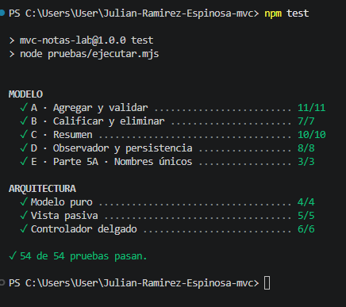
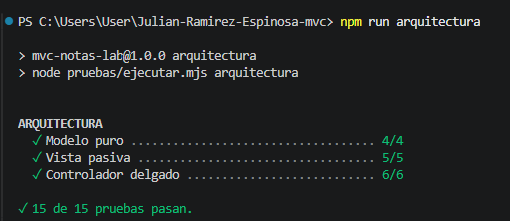
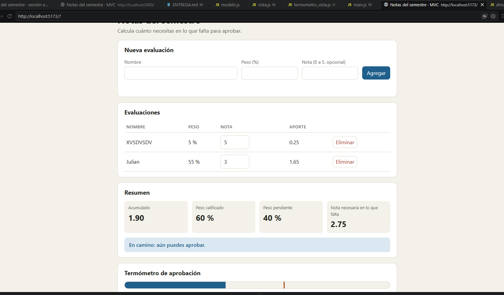
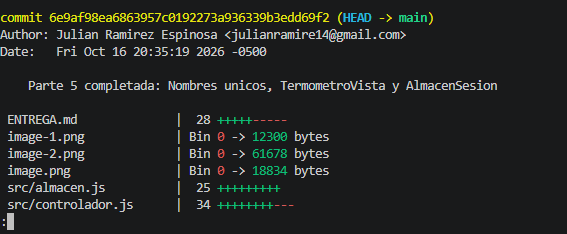

# Entrega · Laboratorio MVC · Notas del semestre

**Equipo:** Julian Ramirez  
**Integrantes:** Julian Ramirez x2
**Repositorio:** (https://github.com/Julian-Ramirez-E/Julian-Ramirez-Espinosa-mvc)

> Completa este archivo a medida que avanzas (cada sección dice en qué parte de la guía se llena).
> Escribe con tus palabras: las respuestas copiadas de la guía o de otro equipo no cuentan.

---

## 1. Mapa de responsabilidades (Parte 1)

Clasifica cada fragmento de `espagueti.html`: **M** (Modelo), **V** (Vista), **C** (Controlador) o **Mezcla**
(en ese caso, escribe qué roles se mezclan). En "¿Por qué?" justifica en una frase.

| # | Fragmento | Rol(es) | ¿Por qué? |
|---|---|---|---|
| 1 | `var n = document.getElementById('nombre').value.trim();` | Vista| porque lee el valoraz de una interfaz de usuario|  porque lee el valoraz de una interfaz de usuario
| 2 | `if (isNaN(p) \|\| p < 1 \|\| p > 100) { err.textContent = 'El peso debe estar entre 1 y 100.'; return; }` | Mezcla  MVC|Mezcla porque realiza una validación de entrada, detiene la ejecucion si no cumple los valores y actualiza el texto del mensaje de error en pantalla | Mezcla porque realiza una validación de entrada, detiene la ejecucion si no cumple los valores y actualiza el texto del mensaje de error en pantalla
| 3 | `if (total + p > 100) { err.textContent = '...'; return; }` | Mezcla VMC|  valida que esta bajo a 100, interrumple el flujo y modifica directamente| 
| 4 | `evals.push({ id: sig++, nombre: n, peso: p, nota: nota });` |Modelo | porque manipula la estructura y el almacenamiento de los datos|   , 
| 5 | `localStorage.setItem('notas.v1', JSON.stringify(evals));` |Modelo |Gestiona la congruencia de los datos en el almacenamiento local | , 
| 6 | `document.getElementById('nombre').value = '';` | Vista|porque modifica el estado visual limpiando el campo |, 
| 7 | `'<input ... onchange="ponerNota(' + e.id + ', this.value)">'` |Mezcla VC |tiene la interfaz enlazandolo  a una funcion logica | , 
| 8 | `nec = Math.ceil(nec * 100 - 1e-9) / 100;` |Modelo | Es una regla de negocio| , 
| 9 | `if (acum + 1e-9 >= 3.0) { txt = '¡Aprobado! ...'; cls = 'ok'; }` |Mezcla MV | evalua que la regla de negocio se cumpla y muestra el aprobado en pantalla | , 
| 10 | `document.getElementById('tabla').innerHTML = filas;` | Visual| porque inserta el html para mostrar los datos|  
| 11 | `function borrar(id) { ...splice...; localStorage.setItem(...); pintar(); }` | Mezcla |porque elimina el dato, coordina el evento y fuerza la muestra en pantalla |  
| 12 | `(e.peso * e.nota / 100).toFixed(2)` | Mezcla MV| realiza un calculo y aplica el formato para mostrar en pantalla | 

## 2. Olores del espagueti (Parte 1)

Lista **al menos 5** problemas de diseño de `espagueti.html`. Para cada uno, escribe qué consecuencia tiene
cuando el proyecto crece y en qué pieza de MVC viviría la solución.

| Olor | Consecuencia | Dónde se arregla (M, V o C) |
|---|---|---|
| | | |
| | | |
| | | |
| | | |
| | | |

## 3. El flujo de «agregar una evaluación» (Parte 6)

Dibuja (a mano y pega una foto, o con texto/Mermaid) el recorrido completo desde que el usuario presiona
**Agregar** hasta que ve la fila nueva en la tabla. Marca en cada paso **el archivo y el método** que actúa.

```text
(tu diagrama aquí)
```

## 4. Evidencias (Partes 2, 3, 4 y 6)

**Salida de `npm test`** (pega el final, donde dice cuántas pruebas pasan):





**Salida de `npm run arquitectura`:**



`

**Captura de pantalla** de la app con las dos vistas (la tabla/resumen y el termómetro): _(pega la imagen o su enlace)_

## 5. Tres cambios, tres lugares (Parte 5)

Después de cada cambio ejecuta `git diff --stat HEAD~1` (o `git show --stat`) y pega el resultado. 
La idea: **cada cambio debía tocar solo las piezas que le corresponden**.

| Cambio | Archivos que tocaste | ¿Era lo esperado? ¿Por qué? |
|---|---|---|
| 5A · Nombres únicos |src/modelo.js y pruebas/modelo.test.js | Sí. Validar que no se repitan nombres es una regla del negocio, así que solo debía modificar la lógica dentro del modelo y agregar su prueba unitaria.|
| 5B · Segunda vista (termómetro) |src/termometro_vista.js y src/main.js | Sí. Creé el archivo de la nueva vista y la conecté en el punto de entrada sin tocar el modelo, porque el modelo solo avisa cuando cambia y las vistas se actualizan solas.|
| 5C · Otro almacén | src/almacen.js y src/main.js|Sí. Creé la nueva forma de guardar datos en el archivo de almacén y la cambié en el archivo principal, sin necesidad de modificar el modelo ni las vistas. |

## 6. Reflexión (Parte 6)

1. En la versión espagueti, ¿qué tuviste que leer o tocar para entender dónde se decide si el estudiante aprobó? ¿Y en la versión MVC? 
En la versión espagueti: Tuve que leer todo el archivo HTML y JavaScript mezclados, buscando entre eventos de botones, manipulación del DOM y lecturas de inputs hasta encontrar la línea específica donde se hacía el cálculo. Todo estaba revuelto en un solo lugar.

En la versión MVC: Fui directamente al archivo src/modelo.js. Al estar la lógica de negocio separada, fue fácil identificar el método del Modelo que calcula la nota final y la condición de aprobación sin tener que revisar nada de la interfaz ni de la pantalla.
2. ¿Por qué el Modelo **no** debe llamar a `alert()` ni a `document`? ¿Qué pasaría con las pruebas del Modelo si lo hiciera?
El Modelo no debe llamar a alert() ni a document porque su única responsabilidad es gestionar los datos y las reglas del negocio, sin importar cómo se muestran en pantalla.

Si el Modelo usara alert() o document:

En las pruebas automáticas: Las pruebas ejecutadas con Node.js o Vitest fallarían inmediatamente porque esos entornos de prueba no tienen un navegador real ni un DOM (document no existe), y las ventanas emergentes como alert() bloquearían la ejecución del código.
3. El Modelo avisa de sus cambios sin saber quién escucha (Observer). ¿Qué ganamos con eso frente a que el Modelo llame directamente a `vista.render()`?
Ganamos desacoplamiento. Al usar el patrón Observer, el Modelo solo notifica que algo cambió y no le importa quién ni cuántas vistas están escuchando.

Si el Modelo llamara directamente a vista.render():

Estaría amarrado a una vista específica.

Al agregar una segunda vista (como el termómetro en la Parte 5B), habríamos tenido que modificar el código interno del Modelo para llamarla también, rompiendo la independencia entre las capas.
4. Elige un olor de MVC (controlador gordo, lógica en la Vista, Modelo que toca la pantalla, Modelo anémico) que te hubiera sido fácil cometer hoy. ¿Cuál y cómo lo evitaron?
El "olor" que más fácil habría cometido es el Controlador gordo.

Cómo lo evitamos: Dejamos que el Controlador funcionara únicamente como un puente o mediador. En lugar de hacer validaciones de datos o cálculos dentro del Controlador, simplemente le pedimos los datos a la Vista y se los pasamos al Modelo para que él aplique las reglas de negocio.
5. ¿Para qué tipo de aplicación **no** usarías MVC? Justifica con lo que viste en el laboratorio.
No usaría MVC para una página web estática o muy sencilla (como un blog simple, una landing page informativa o un portafolio personal) ni para scripts/herramientas de una sola tarea de línea de comandos.

 Como vimos en el laboratorio, implementar MVC requiere crear varios archivos (modelo.js, vista.js, controlador.js, almacen.js, main.js) y conectar componentes mediante eventos y suscripciones. Para una aplicación pequeña sin estados complejos ni interactividad, esta estructura añade demasiada complejidad inicial innecesaria cuando un solo archivo simple o la versión básica bastaría.